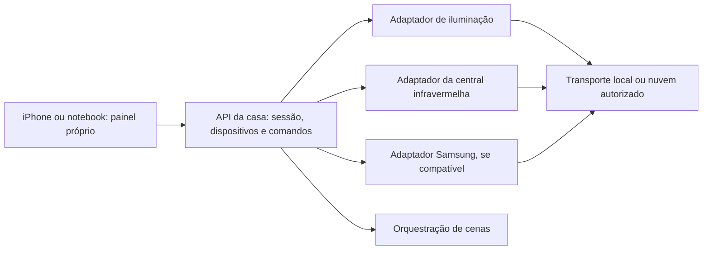

# Mapa técnico do aplicativo da casa

Atualizado em 15/10/2026. Escopo: analisar os APKs Android já obtidos e especificar o necessário para um app próprio, enquanto o notebook está fora da rede doméstica. Não houve login, execução dos apps, consulta a contas ou envio de comandos aos aparelhos.

## Resultado e decisão proposta

Os dois APKs contêm interfaces da família Thingclips para contas, casas, dispositivos, esquemas de funções e cenas. Isso permite desenhar um modelo comum para o painel. A autorização para acessar os aparelhos continua separada da presença desse SDK.

Minha proposta é um painel web instalável no iPhone, com uma API própria e adaptadores para lâmpadas, central IR e, quando compatível, TV Samsung pela rede. O adaptador poderá usar uma central local comprovada ou APIs cloud autorizadas. A escolha do transporte ficará atrás dessa interface, para que a tela não dependa do SDK das marcas.

Este desenho é uma recomendação, não uma integração implementada. Se o transporte escolhido for local, será necessário manter uma central ligada em casa para uso remoto. Um backend cloud depende de vínculo autorizado das contas/aparelhos e dos serviços disponíveis. Veja as fontes e condições em [mapa-fontes-integracao.md](mapa-fontes-integracao.md).

## O que foi encontrado

| Área | Evidência estática | Consequência para o app |
|---|---|---|
| Inventário | `IThingHome`, `HomeBean` e `DeviceBean` nos dois APKs | Separar conta, casa, cômodo e aparelho; não usar apenas o nome amigável como identidade |
| Recursos por aparelho | `DeviceBean.getSchema()`, `getSchemaMap()`, `getDpCodes()` e `getDps()` | Descobrir capacidades e valores atuais; o APK não determina os DPs particulares das lâmpadas da casa |
| Comandos | `IThingDevice.publishDps`, `publishCommands`, `getDp` e `getDpList` | Converter ações do painel em comandos validados pelo esquema do aparelho |
| Atualizações | Métodos de registro de listeners no Geonav; callbacks de DPs/rede/status no Izy | Atualizar estado e conectividade sem confundir sucesso do envio com confirmação física |
| Infravermelho | Geonav declara `infraredPublishDps(String, String, String, IResultCallback)`; declaração ausente na interface equivalente do Izy analisado | Implementar um adaptador IR separado; os três parâmetros de texto não tiveram sua semântica integral recuperada |
| Rede | Geonav possui `getIsLocalOnline()` e `isCloudOnline()`; Izy declara modos Auto/Http/Internet/Local/Mqtt | Representar conectividade e transporte separadamente; as declarações não comprovam suporte LAN dos aparelhos reais |
| Solicitações genéricas | Geonav expõe `IThingSmartRequest.requestWithApiName` e variantes com/sem sessão | Há uma camada de API do SDK; encontrar sua interface não comprova permissão nem define um endpoint público reutilizável |
| Interface dos painéis | Kits JavaScript empacotados expõem wrappers de DPs e cenas | Parte da interface delega a plugins; kits inspecionados não revelaram comandos IR completos nem o mapa dos controles reais |

O relatório do Izy está em [MAPA-IZY.md](MAPA-IZY.md), e o dos kits em [MAPA-KITS-JS.md](MAPA-KITS-JS.md). A inspeção dos kits foi limitada aos arquivos selecionados; não demonstra ausência de IR no app inteiro.

A ponte JavaScript de ambos os apps encaminha `publishDps`, `publishDpsWithPipeType` e `queryDps` para `TUNIDeviceControlManager`. No Izy, a leitura formal DEX dos DTOs associados encontrou `DpsPublish` com `deviceId`, `dps`, `mode`, `options` e `pipelines`, e `QueryDps` com `deviceId`, `dpIds` e `queryType`. São nomes e tipos de campos recuperados do pacote, sem confirmação do significado dos inteiros, da serialização completa ou da API de rede. Esse resultado complementa a observação dos wrappers; não define automaticamente um payload HTTP para o nosso backend.

## Autenticação e acesso

O app precisa de uma sessão própria para o proprietário e de um vínculo operacional por integração. Izy e Geonav devem ser tratados como contextos de conta diferentes. A documentação Tuya confirma a independência das contas OEM; criar um app/SDK próprio não importa os aparelhos dessas contas. A existência de uma API oficial para listar dispositivos ou obter `local_key` só ajuda após o vínculo que dê acesso a esses objetos.

Para o caminho local, faltam IP local, versão do protocolo e, quando exigida, `local_key` válida. No Geonav, `DeviceBean` declara o campo e os métodos correspondentes. Isso comprova a estrutura de dados do SDK, não a presença da chave particular da casa no APK. Nenhuma chave operacional foi obtida.

Credenciais de projeto, sessões do fornecedor e chaves locais deverão ficar no backend/armazenamento privado, com referências opacas no modelo do app. A análise não extraiu nem reutilizou identidade ou credenciais de desenvolvedor dos fabricantes.

## Iluminação

O app deve oferecer ligar/desligar e, quando o esquema permitir, brilho, temperatura de cor e cor. Cada capacidade precisa apontar para um DP ou comando do aparelho, com tipo, leitura/escrita, limites, passo e escala. As duas lâmpadas poderão ter esquemas diferentes mesmo sendo da mesma marca.

Ainda não sabemos quais DPs correspondem a essas funções, nem seus intervalos. Não serão fixados números usuais como se fossem comprovados. O primeiro teste será ler esquema/estado e validar uma operação reversível em uma lâmpada, com observação física do proprietário.

## TV, ar e central IR

A central física e cada controle lógico devem ser objetos separados. Para cada controle será necessário identificar o vínculo com o emissor, o identificador do controle e a forma autorizada de obter/enviar comandos. Se forem usados códigos aprendidos, registrar origem e nome do comando; se for usado catálogo, registrar os identificadores disponíveis pelo serviço.

No ar Electrolux, verificar se temperatura, modo e ventilação são transmitidos juntos e quais combinações são válidas. Na TV, distinguir um botão Power alternante de comandos explícitos de ligar e desligar. A API deve representar essa diferença para evitar repetições automáticas de um comando alternante.

O estado de um equipamento controlado por IR deverá ser estimado enquanto não houver confirmação por rede ou sensor. Um callback de envio, status do controle virtual ou resposta HTTP não basta para afirmar que o aparelho recebeu o sinal. A integração Samsung pela rede é uma alternativa a testar após identificar o modelo e o acesso disponível.

## Cenas e estado dos comandos

Uma cena que mistura Izy e Geonav será inicialmente uma sequência de comandos do nosso backend. O resultado deverá registrar cada etapa, incluindo falhas e execução parcial. Não se deve prometer uma transação atômica entre aparelhos ou reenviar Power alternante sem conhecer o efeito.

Estados propostos para uma execução: `queued`, `sent`, `acknowledged`, `confirmed`, `failed` ou `unknown`. O estado exibido do aparelho terá valor, horário, origem e confiança (`reported`, `estimated` ou `unknown`). Esses nomes são escolhas de projeto, não termos extraídos literalmente dos SDKs.

## Contrato e critérios de aceitação

[contrato-app.json](contrato-app.json) descreve uma proposta de recursos, operações e dados necessários. É uma especificação para a implementação futura, sem comandos conectados ou credenciais.

| Teste posterior | Resultado necessário |
|---|---|
| Descoberta | Reconhecer os IDs do inventário e obter o IP/protocolo local, se disponível |
| Acesso | Listar apenas os aparelhos autorizados e distinguir as contas/integrações |
| Esquema | Identificar tipos, modos e intervalos dos DPs de cada lâmpada |
| Lâmpada | Enviar uma operação, observar o efeito e receber a atualização de estado |
| IR | Identificar emissor/controles e comprovar uma operação na TV e no ar |
| Controle físico | Observar o que acontece ao estado do painel quando se usa o controle original |
| Falha/reconexão | Indicar offline/erro e recuperar a conexão sem repetir comandos ambíguos |
| Cena conjunta | Mostrar sucesso ou falha por etapa, sem ocultar execução parcial |

## Evidências e limites

Geonav 2.0.0, SHA-256 `147383eb09edc63ae5429f7896ddd4986f19b120b05c9bc48695a6bc3d93c835`:

- `ThingHomeSdk`: `ev_c0f959deab35c99e8edc8e073a0c2b12ec1525dece19914778c5d4bf4028db1e`.
- `IThingDevice`: `ev_04440f66faeac043af3cb05e6e9472593a3f6f30e0ff4431104112a4babb1277`.
- Corpo de `ThingHomeSdk.newDeviceInstance`: `ev_8f6b608c8a898cf1220ea974460cd6373ca85b84c3da0694b870093c2975699d`. O método delega a `IThingHomePlugin`; não recupera por si só a escolha efetiva de transporte.
- `DeviceBean`: `ev_df1e22258d7ddf13ddc9dbaac808b69a81b9c17828bc28d2a368e00c0772f4d4`.
- `IThingSmartRequest`: `ev_326a9eff84666c32c025701ed73a65f2442c35bbf5a652ba2bd82eaf2211944e`.

Esses cinco registros foram exportados em `relatorios/rea-geonav-20261015.bundle.json`, além dos arquivos individuais `geo_*-20261015-raw.json`. A análise de referências de `infraredPublishDps` atingiu o limite de 120 segundos; não estabeleceu a cadeia completa de chamadores. O erro parcial foi preservado em `relatorios/geo-ir-refs-20261015-raw.json`.

No Izy, uma consulta REA de inventário de classe também atingiu 120 segundos. A investigação prosseguiu com leitura formal das tabelas DEX de 28 classes selecionadas, preservando assinaturas, campos, índices e hashes em `relatorios/izy-dex-members-20261015.json`. Essa leitura é evidência estática independente, identificada como `IZY-DEX-01`, e não uma decompilação REA concluída. A árvore dos kits Geonav teve análise REA JavaScript concluída, Evidence `ev_9a4b76f58789ebf6e54493010fd0175fa474bab2d43a710f6b042f0320082db2`.

O inventário formal DEX dos dois apps e as strings candidatas estão em `relatorios/dex-sementes-20261015.json` e `relatorios/strings-api-candidatas-20261015.json`. Strings de nomes de API são pistas, não chamadas observadas. As evidências do Izy e dos kits estão descritas nos relatórios correspondentes. As versões Android podem diferir dos apps iOS instalados. O comportamento real dos aparelhos, os códigos IR e o acesso às contas permanecem pendentes.
